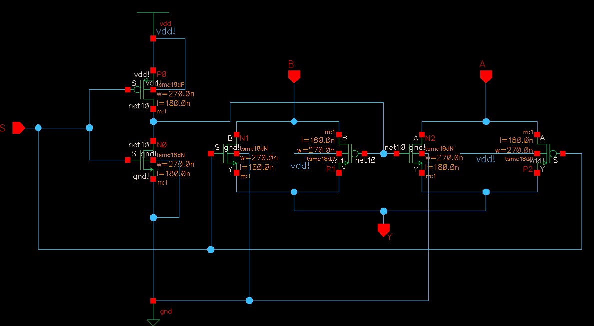
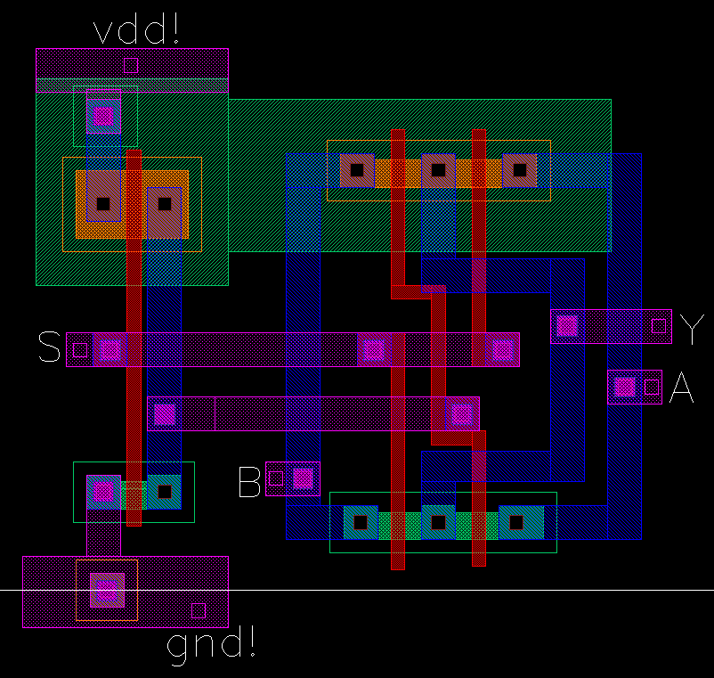
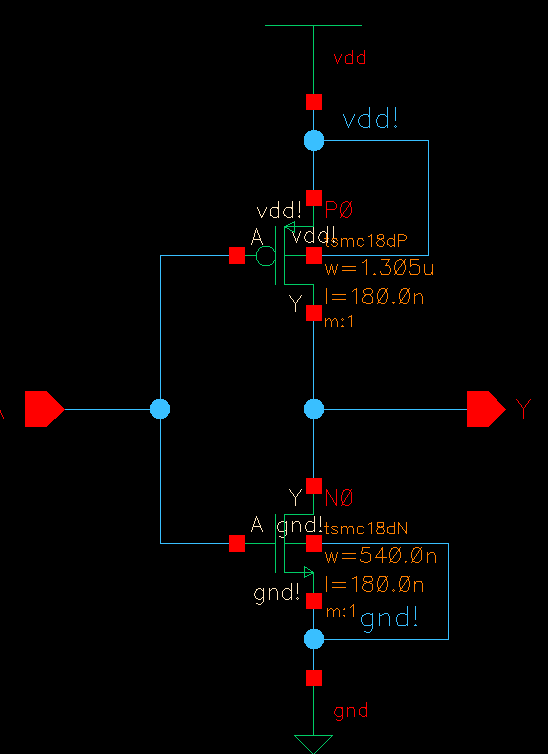
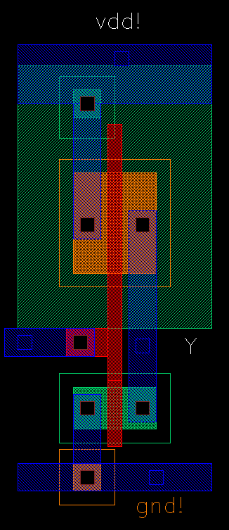
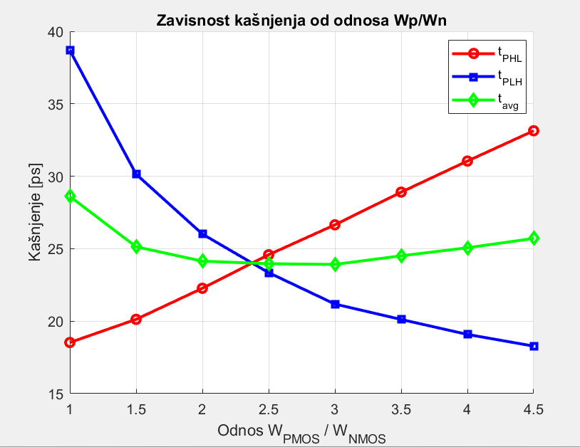
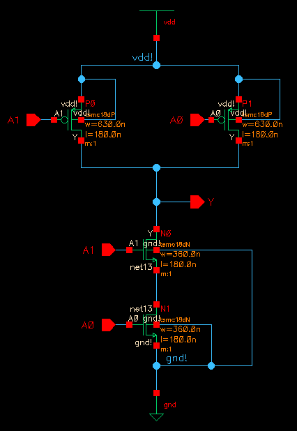
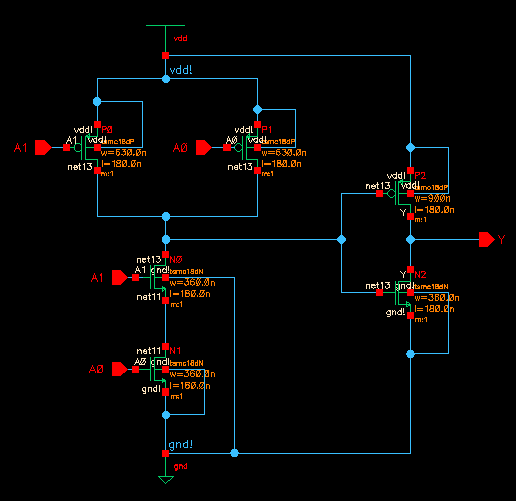
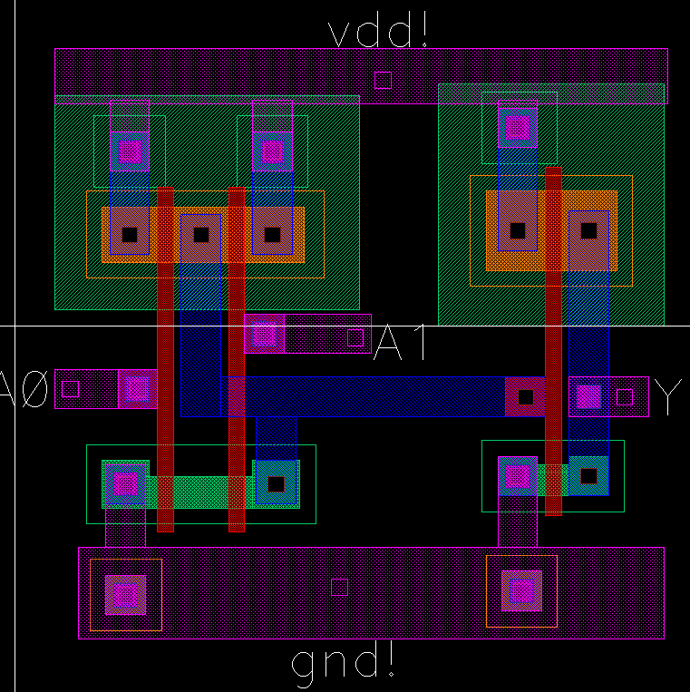
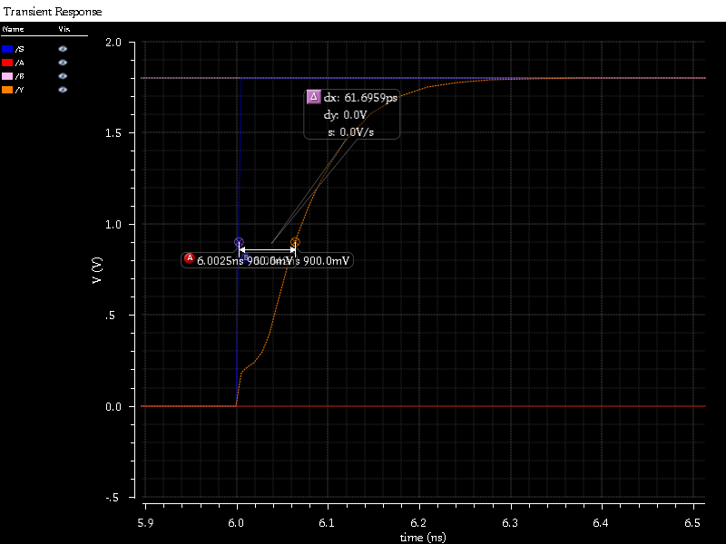

# CMOS Logic Cells in 180 nm – Full-Custom Design (Cadence Virtuoso)

Full-custom design of basic CMOS cells in a **TSMC 180 nm** process (NCSU CDK, V<sub>DD</sub> = 1.8 V): an **inverter**, a **2-input NAND**, a **2-input AND** and a **2-to-1 transmission-gate multiplexer**.
Each cell went through the complete flow, from transistor sizing to post-layout timing:

**schematic → functional simulation (Spectre) → layout → parasitic extraction → post-layout simulation → delay analysis**

University project for the course *Integrated Circuit Design* (Projektovanje integrisanih kola), School of Electrical Engineering, University of Belgrade, 2025.
Team project by **Marko Ivković** and **Senad Nogović**.

| 2-to-1 multiplexer – schematic | 2-to-1 multiplexer – layout |
|:---:|:---:|
|  |  |

## 1. CMOS inverter: transistor sizing

The PMOS/NMOS width ratio was swept from 1 to 4.5 in post-layout simulation, and the propagation delays were measured for each point (plotted in MATLAB, `scripts/wp_wn_sweep.m`).
t<sub>PLH</sub> falls and t<sub>PHL</sub> rises as the PMOS gets wider. The curves cross at **W<sub>P</sub>/W<sub>N</sub> ≈ 2.5**, which gives balanced rise and fall delays and close to the minimum average delay.

| Schematic | Layout | Delay vs. W<sub>P</sub>/W<sub>N</sub> |
|:---:|:---:|:---:|
|  |  |  |

Optimised inverter (load 3 fF):

| | Schematic | Post-layout |
|---|---:|---:|
| t<sub>PHL</sub> | 25.2 ps | 24.2 ps |
| t<sub>PLH</sub> | 24.8 ps | 23.7 ps |

## 2. NAND2 and AND2

The AND gate is a NAND2 followed by an inverter. The PMOS transistors are wider (W<sub>N</sub> = 360 nm, W<sub>P</sub> = 630 nm) so that the rising and falling delays are close. All input transitions were simulated, and the critical one was found for each gate (load 5 fF).

| NAND2 schematic | AND2 schematic | AND2 layout |
|:---:|:---:|:---:|
|  |  |  |

| Worst-case delay | Schematic | Post-layout |
|---|---:|---:|
| NAND2 | 59.8 ps | 56.9 ps |
| AND2 | 99.4 ps | 98.2 ps |

The delay depends on which input switches. Switching the input of the bottom NMOS in the series stack also has to charge or discharge the internal node, so it is the slower case.

## 3. 2-to-1 multiplexer with transmission gates

The multiplexer uses two CMOS transmission gates and an inverter for the select signal. Transmission gates keep a low on-resistance over the whole output voltage range: the NMOS passes a strong 0 and the PMOS a strong 1.

| Worst-case delay | Schematic | Post-layout |
|---|---:|---:|
| MUX 2:1 (A = 0, B = 1, S: 0 → 1) | 53.9 ps | 61.7 ps |

The critical transition is the one where the select signal must first pass through the inverter before it turns on the PMOS of the B path. In the post-layout simulation, the parasitics add about 8 ps.



## Repository structure

```
virtuoso/pik25_g11/   Cadence Virtuoso library (schematic, symbol, layout and extracted views)
                      cells: inv2, nand, and, mux_2in1
sim/                  Spectre stimulus files for the transient simulations
scripts/              MATLAB script for the W_P/W_N sweep plot
docs/                 project reports, phase 1 and phase 2 (in Serbian, .docx)
images/               schematics, layouts and simulation waveforms
```

To open the library, add `virtuoso/pik25_g11` to `cds.lib` in a Cadence installation with the NCSU CDK (`NCSU_TechLib_tsmc02d`).

## Tools

Cadence Virtuoso (Schematic Editor, Layout Suite, ADE) · Spectre · NCSU CDK, TSMC 180 nm · MATLAB
